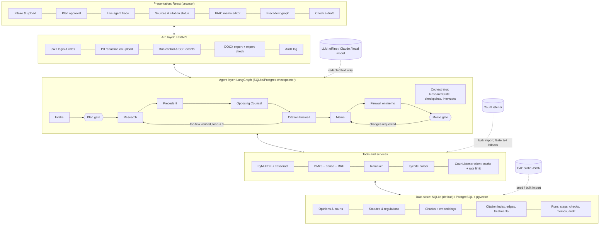
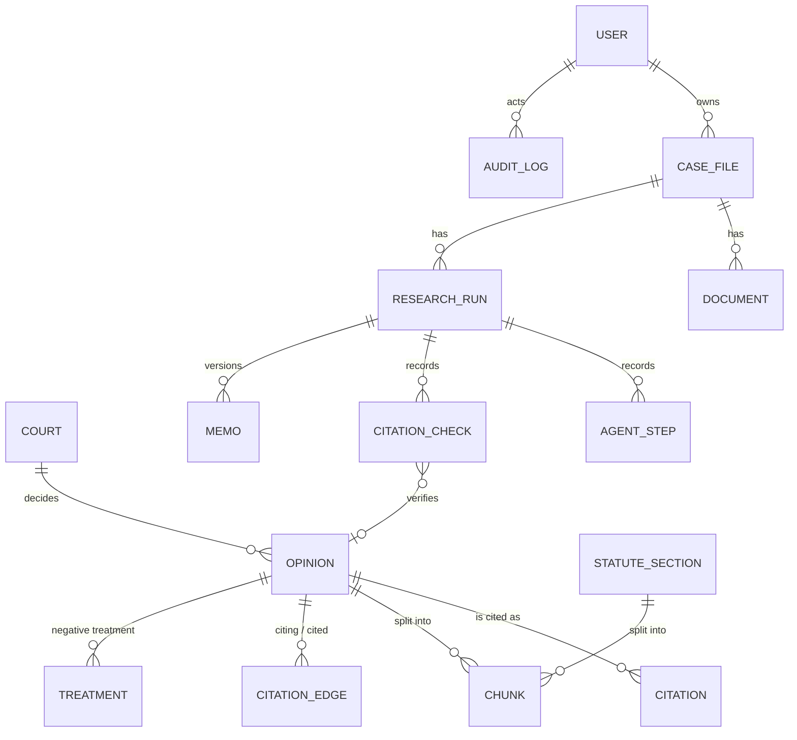

# STARE design document (Milestone 2)

This document describes the system as built. It follows the proposal's Chapter 5 and records where
the implementation refines it. Module interfaces and the HTTP API are specified in
[CONTRACTS.md](CONTRACTS.md), and implementation decisions are in [../DECISIONS.md](../DECISIONS.md).

## 1. Architecture

### Request flow

1. **Upload** (`POST /api/matters/{id}/documents`). The file is read page by page with PyMuPDF; pages
   with fewer than 40 characters are OCR'd with Tesseract. The PII redactor (Presidio + regex) replaces
   names, emails, phones, SSNs, addresses and IDs with placeholders (`[PLAINTIFF]`, `[PERSON_1]` …).
   Only the redacted text and the entity metadata are stored. The raw bytes are discarded.
2. **Start run**. `ResearchService.start_run` creates a `ResearchRun` and invokes the graph in a
   worker thread. The Intake Agent extracts the case record (court, parties, claims, key dates,
   posture) and drafts the research plan from the legal-elements knowledge base. The graph then stops
   at the **plan gate** (`interrupt`). Saving an edited case record at this gate re-redacts the typed
   text and redrafts the plan from it, so added or removed claims are reflected in what gets approved.
3. **Approve plan** (attorney only). The approved, possibly edited, plan is passed into the graph
   with `Command(resume=…)`. The Research Agent issues one query per legal element (RAG-Fusion). The
   Precedent Agent ranks results for the court of filing. The Opposing Counsel Agent searches for
   adverse authority. The Citation Firewall verifies the shortlist and the adverse set, and if too few
   authorities survive, the Research Agent runs again with the rejected list (at most 3 loops).
4. **Memo**. The Memo Agent drafts IRAC from verified authority only. A second Firewall pass checks
   every citation in the memo text and removes any sentence whose citation fails. The graph stops at
   the **memo gate**.
5. **Approve memo** (attorney only). If the attorney has edited the memo, only the prose sections
   (question presented, issue, rule, application, conclusion, adverse authority) are taken from the
   edit; the reference list, warnings and removals stay the server's. The edits are verified first. A
   new failing citation returns HTTP 422 with the list of problems. **Export** rechecks every
   citation, refuses (409) unless all are verified or acknowledged warnings, and writes the audit
   entry.

Each agent emits `TraceEvent`s (running → done), which are persisted as `AgentStep` rows and streamed
over SSE to the live trace. Gate transitions are compare-and-set updates on the run's status, so a
double-clicked approval cannot resume the graph twice (which would deliver a plan approval to the memo
gate).

## 2. Citation Firewall

| Gate | Module | Check | Outcome |
|---|---|---|---|
| 1 Extract | `citations/parser.py` | eyecite full, short-form and id. citations; regex fallback for statutes, regulations and neutral/WL cites; attaches the quotation in the same sentence | `fail` if unparseable |
| 2 Exists | `citations/gates.py`, `index.py`, `courtlistener.py` | volume/reporter/page in the local citation index → Caselaw Access Project volume listings (static.case.law; a covered volume with no case beginning at that page proves non-existence) → CourtListener API; **case-name similarity ≥ 0.60** with the opinion found there | `fail` (not found or name mismatch), `unresolved` (API unavailable, or missing only from CourtListener's anonymous search index) |
| 3 Quote | `citations/quote.py` | normalised exact match passes; similarity ≥ 0.90 warns; lower fails. Ellipsis fragments must appear in order. A quote found only in a dissent or concurrence warns | `pass` / `warn` / `fail` / `skip` |
| 4 Good law | `citations/gates.py`, `treatment.py` | curated `Treatment` rows (e.g. superseded by the ADAAA); negative edges; citing-opinion text scan. The scan requires the phrase to apply *to* this case and the citing court to have authority over it | `warn` (never silently removed) |

Status: Gate 2 or 3 `fail` → **blocked**; `unresolved` → **unresolved** (never exportable); any
`warn` → **warning**; otherwise **verified**. `CitationFirewall.filter_text` removes whole sentences
whose citations are blocked or unresolved.

## 3. Authority ranking

`AuthorityRanker.rank(deciding_court, filing_court, published)` implements Table 26. The Precedent
Agent's final score is `0.5 × retrieval relevance + 0.5 × authority weight`. Statutes are binding
(1.0) and EEOC regulations are persuasive (0.7). An authority with a Gate 4 warning becomes
**flagged**: it is excluded from rule support and listed as a warning.

## 4. Data model

The tables are in `backend/stare/db/models.py`. The implementation adds the following to the
proposal's ER diagram:

* `citations`: the citation index, holding official and parallel cites per opinion
* `treatments`: curated legislative supersession and similar treatment
* `chunks.part`: majority, dissent, concurrence or separate
* `audit_log` and `settings`

Embeddings are a pgvector `vector(dim)` on PostgreSQL and a float32 BLOB on SQLite (`EmbeddingType`).

## 5. Retrieval

* **Chunking.** Paragraph-aware chunks of about 350 tokens with a 60-token overlap. Each statute chunk
  is prefixed with its citation and heading.
* **BM25.** Okapi BM25 (k1 = 1.5, b = 0.75) over a legal tokenizer that turns reporter cites into
  `cite:` tokens and section symbols into `sec:` prefix tokens.
* **Dense.** LSA (TF-IDF + truncated SVD) by default, or fastembed / sentence-transformers.
* **Fusion.** Reciprocal Rank Fusion (k = 60) of BM25 and dense, and again across the queries of one
  plan item (RAG-Fusion).
* **Rerank.** A lexical feature reranker by default, or a cross-encoder.

## 6. Security and privacy

* **Authentication and roles.** JWT (HS256) authentication with three roles. Paralegals cannot approve
  or export; only administrators manage users, settings and the audit log.
* **Personal data.**
  * PII is redacted at upload, before any agent runs.
  * Edits to redacted text are re-redacted. New identifiers get placeholders numbered after the ones
    already in the text, so a newly typed name never shares `[PERSON_1]` with someone else.
  * Hand-typed case-record fields and the attorney's "request changes" instruction are redacted too.
  * Famous case names that are also surnames (Hicks, Hubbard, Kasten …) are protected only until the
    document uses the name for a person ("Ms. Hubbard", "John Hicks").
  * `assert_redacted` blocks LLM calls that still contain identifiers.
  * The audit log stores counts and identifiers, never client text.
* **Separate opinions.** Dissents, concurrences and syllabi are marked at ingest and are never quoted
  as holdings.

## 7. Deployment

The laptop setup is SQLite, offline LLM and LSA, with `stare serve` and `npm run dev`.
`docker-compose.yml` runs PostgreSQL 16 + pgvector, the API (uvicorn) and the web app (nginx serving
the built SPA, proxying `/api` with SSE buffering off).
